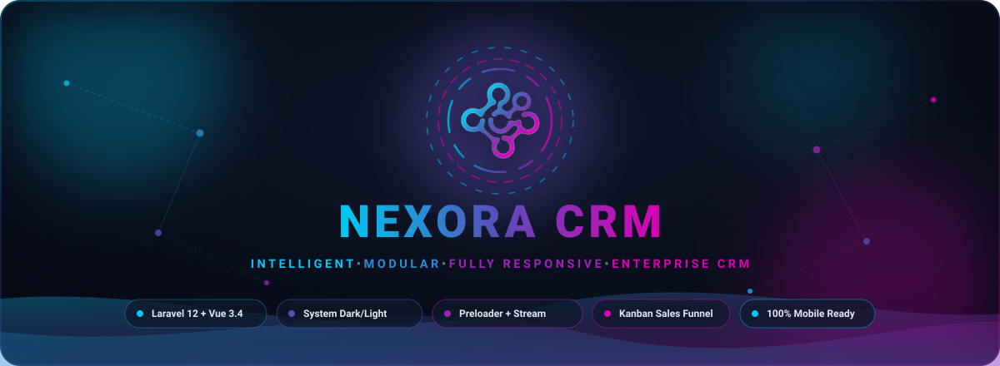
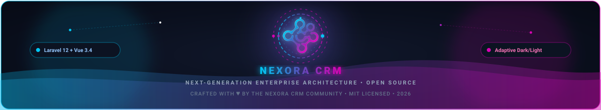

<div align="center">

<!-- Animated Header Interactive Banner (Self-contained vector SVG styled with Nexora Brand Gradient: Cyan #01C7F4 → Blue #2590D6 → Indigo #5A4DB9 → Violet #9E24B7 → Magenta #D803B3) -->
<a href="#-our-pledge">
  
</a>

<!-- Animated SVG Live Telemetry & CoC Status Ticker (Zero External Dependencies) -->
<div align="center">
  
</div>

<br/>

<!-- Community & Governance Badges (Matching Logo Colorway) -->
<p align="center">
  <a href="https://www.contributor-covenant.org"></a>
  
  
  
  <a href="https://github.com/Isuru-CodeX/NoxusCRM"></a>
  <a href="LICENSE"></a>
</p>

<!-- Quick Navigation Links -->
<p align="center">
  <a href="#-our-pledge"><b>🌟 Our Pledge</b></a> •
  <a href="#-community-values--standards"><b>✨ Standards</b></a> •
  <a href="#-prohibited-conduct"><b>🚫 Prohibited Conduct</b></a> •
  <a href="#-scope-of-application"><b>🌐 Scope</b></a> •
  <a href="#-responsibilities-of-maintainers"><b>🛡️ Maintainer Duties</b></a> •
  <a href="#-tiered-enforcement-matrix"><b>⚖️ Enforcement Matrix</b></a> •
  <a href="#-confidential-reporting-workflow"><b>📬 Reporting Protocol</b></a> •
  <a href="#-community--maintainers"><b>👥 Maintainers</b></a>
</p>

</div>

---

<!-- Animated Gradient Divider -->


## 🌟 Our Pledge

At **Nexora** (NoxusCRM), we are committed to providing a friendly, safe, welcoming, and harassment-free environment for all participants, regardless of age, body size, visible or invisible disability, ethnicity, sex characteristics, gender identity and expression, level of experience, education, socio-economic status, nationality, personal appearance, race, caste, religion, or sexual identity and orientation.

We pledge to act and interact in ways that contribute to an open, welcoming, diverse, inclusive, and healthy community where every engineer, designer, documentation writer, bug reporter, and open-source enthusiast feels empowered to participate, innovate, and thrive.

```
┌────────────────────────────────────────────────────────────────────────────────────────┐
│                        Nexora Community Cultural Pillars                               │
├───────────────────┬───────────────────┬──────────────────────┬─────────────────────────┤
│ 🤝 Radical Respect│ 💡 Empathy First  │ 🛡️ Safe Harbor       │ 🚀 Growth Mindset       │
├───────────────────┼───────────────────┼──────────────────────┼─────────────────────────┤
│ • Civil debates   │ • Understand intent│ • Zero retaliation   │ • Welcoming newcomers   │
│ • No ad-hominems  │ • Kind critiques  │ • Strict privacy     │ • Mentorship focus      │
│ • Diverse insights│ • Active listening│ • Fast remediation   │ • Continuous learning   │
└───────────────────┴───────────────────┴──────────────────────┴─────────────────────────┘
```

---

<!-- Animated Gradient Divider -->


## ✨ Community Values & Standards

We strive to cultivate an environment where open collaboration flourishes. All contributors and participants are expected to adhere to the following standards across all project interactions:

<table>
  <tr>
    <td width="50%">
      <h3>🟢 Expected Positive Behaviors</h3>
      <ul>
        <li><strong>Welcoming &amp; Inclusive Language:</strong> Use affirmative, gender-neutral, and encouraging communication in all pull requests, issues, discussions, and commit messages.</li>
        <li><strong>Respectful Discourse:</strong> Value differing perspectives, technical opinions, and life experiences; critique implementations and ideas, never individuals.</li>
        <li><strong>Constructive Code Reviews:</strong> Offer actionable, compassionate feedback during reviews. Explain the <em>why</em> behind suggested changes with technical context.</li>
        <li><strong>Graceful Acceptance:</strong> Receive constructive technical feedback with an open mind, focusing collaboratively on what is best for the long-term health of the codebase.</li>
        <li><strong>Empathy &amp; Patience:</strong> Exercise kindness toward beginners, first-time open-source contributors, and non-native English speakers.</li>
        <li><strong>Community Stewardship:</strong> Prioritize the shared goals of the Nexora ecosystem over personal preferences or egos.</li>
      </ul>
    </td>
    <td width="50%">
      <h3>🔴 Unacceptable Behaviors</h3>
      <ul>
        <li><strong>Harassment &amp; Discrimination:</strong> Any verbal or written conduct that demeans, intimidates, or degrades someone on the basis of personal identity or characteristics.</li>
        <li><strong>Sexualized Content:</strong> The use of sexualized language, imagery, innuendo, or unwelcome sexual advances in issues, avatars, comments, or documentation.</li>
        <li><strong>Trolling &amp; Hostile Tone:</strong> Bad-faith arguments, deliberate baiting, insulting or derogatory remarks, and personal or political attacks.</li>
        <li><strong>Doxxing &amp; Privacy Violations:</strong> Publishing another individual's private information (e.g., physical addresses, phone numbers, private emails, IP addresses) without explicit consent.</li>
        <li><strong>Spam &amp; Disruption:</strong> Unsolicited self-promotion, advertising, flooding issue queues, or intentional distraction of technical conversations.</li>
        <li><strong>Retaliation:</strong> Any retaliatory action or harassment against an individual who reported an incident or supported an investigation.</li>
      </ul>
    </td>
  </tr>
</table>

> [!IMPORTANT]
> Nexora enforces a **strict zero-tolerance policy** toward hate speech, discrimination, harassment, and intentional privacy breaches. Participants engaging in unacceptable conduct are subject to immediate administrative sanctions.

---

<!-- Animated Gradient Divider -->


## 🚫 Prohibited Conduct

The following behaviors are strictly prohibited within any Nexora communication space or repository:

1. **Harassment, Bullying & Abuse**: Persistent, unwelcome attention or derogatory comments directed at an individual or group.
2. **Derogatory Language**: Using slurs, insults, or dismissive remarks regarding someone's identity, technical background, or proficiency.
3. **Public or Private Intimidation**: Coercing, threatening violence, or attempting to pressure contributors into specific viewpoints or actions.
4. **Deliberate Misgendering**: Refusing to use a participant's stated pronouns or mocking gender identities.
5. **Malicious Code Submissions**: Knowingly submitting exploits, backdoors, hidden telemetry, malware, or destructive code to the project.
6. **Advocating or Encouraging Any of the Above**: Urging others to harass a community member or defending abusive behavior.

---

<!-- Animated Gradient Divider -->


## 🌐 Scope of Application

This Code of Conduct applies within all official project spaces, including:

* The official GitHub repository (`Isuru-CodeX/NoxusCRM`)
* GitHub Pull Requests, Issues, Commit Messages, and Discussions
* Project Discord servers, Slack channels, and chat groups
* Community social media interactions, webinars, and virtual meetups
* Official email communications relating to Nexora CRM

It also applies when an individual is **officially representing** Nexora CRM in public spaces—such as using an official project e-mail address, posting via an official social media account, or acting as an appointed representative at an online or offline conference or event.

---

<!-- Animated Gradient Divider -->


## 🛡️ Responsibilities of Maintainers

Project maintainers are guardians of our community standards. Maintainers are responsible for:

* **Clarifying Expectations:** Setting a professional, respectful tone and leading by example in all discussions and code reviews.
* **Proactive Monitoring:** Reviewing issue queues, PR comments, and public project channels to maintain healthy discourse.
* **Fair & Decisive Action:** Taking prompt, impartial, and proportionate corrective action whenever instances of unacceptable behavior occur.
* **Confidentiality:** Maintaining strict confidentiality regarding the identities of incident reporters and respondents during any investigation.
* **Content Moderation:** Editing, hiding, or deleting comments, commits, issues, and PRs that violate this Code of Conduct.

---

<!-- Animated Gradient Divider -->


## ⚖️ Tiered Enforcement Matrix

When a violation of the Code of Conduct is reported, maintainers will follow a structured, multi-tiered resolution process to determine fair and proportionate consequences:

```
┌────────────────────────────────────────────────────────────────────────────────────────┐
│                         Incident Resolution Lifecycle Stream                           │
├────────────────────┬────────────────────┬────────────────────┬─────────────────────────┤
│ 1. Ingestion       │ 2. Triage & Scope  │ 3. Investigation   │ 4. Enforcement Action   │
├────────────────────┼────────────────────┼────────────────────┼─────────────────────────┤
│ • Private report   │ • Initial review   │ • Evidence audit   │ • Tiered sanction       │
│ • Secure logging   │ • Confidential log │ • Direct outreach  │ • Status update sent    │
│ • SLA: < 48 Hours  │ • Safety triage    │ • Impartial review │ • Community protection  │
└────────────────────┴────────────────────┴────────────────────┴─────────────────────────┘
```

<br/>

| Tier | Category | Description & Community Impact | Enforcement Action & Sanctions |
|:---:|:---|:---|:---|
| **Tier 1** | **Correction** | Minor infractions, unconstructive tone, or unintentional use of inappropriate/dismissive language without malicious intent. | **Private written notification** from maintainers clarifying the violation, explaining expectations, and requesting retraction or editing of the comment. |
| **Tier 2** | **Formal Warning** | Repeated minor offenses or a single incident of unprofessional, hostile, or harassing conduct (e.g., insulting remarks, trolling). | **Formal written warning** documented on record, outlining consequences of continued violations. Temporary 7-day cooldown or moderation restriction applied. |
| **Tier 3** | **Temporary Suspension** | Serious violations, including sustained harassment, targeted demeaning language, or pattern of abusive behavior across project channels. | **Temporary suspension (30 days)** from all Nexora repositories, discussions, pull requests, issues, and associated communication platforms. |
| **Tier 4** | **Permanent Ban** | Egregious violations, including hate speech, doxxing, sexualized advances, malicious exploits, or continued harassment following suspension. | **Permanent expulsion & block** from all Nexora repositories, organization spaces, leadership roles, and future project interactions. |

> [!NOTE]
> Maintainers reserve the right to escalate directly to higher tiers (including immediate Tier 4 permanent ban) in severe instances where the safety or well-being of community members is at immediate risk.

---

<!-- Animated Gradient Divider -->


## 📬 Confidential Reporting Workflow

If you experience or witness behavior that violates this Code of Conduct, or have any related safety concerns, please report it immediately:

```
                  [Step 1: Incident Occurs]
                              │
                              ▼
        [Step 2: Submit Private Report to Maintainers]
        Email: security@nexora.io
        GitHub: Private Security Advisory (see SECURITY.md)
                              │
                              ▼
            [Step 3: Confidential Acknowledgement]
                  (Within 48 Business Hours)
                              │
                              ▼
         [Step 4: Fact-Finding & Impartial Review]
                              │
                              ▼
        [Step 5: Proportionate Enforcement & Closure]
```

### 📋 What to Include in Your Report

To help us investigate and resolve the issue quickly, please provide as much context as possible:

1. **Your Contact Information:** (Will remain 100% confidential throughout the entire process).
2. **Identifying Information:** The username, name, or profile of the person(s) involved in the incident.
3. **Date, Time & Platform:** When and where the incident took place (e.g., GitHub issue link, PR #, comment URL, or chat room).
4. **Description of the Conduct:** A clear, factual description of what occurred and how it violated this Code of Conduct.
5. **Supporting Evidence:** Screenshots, links, or copied transcripts of the interactions.
6. **Witnesses:** Any other individuals who observed the incident or can provide additional context.

> [!TIP]
> All reports will be handled with **strict discretion and confidentiality**. We will never disclose your identity to the reported party without your prior explicit written permission.

---

<!-- Animated Gradient Divider -->


## 🤝 Attribution & Upstream Alignment

This Code of Conduct is adapted from the [Contributor Covenant](https://www.contributor-covenant.org), version 2.1, available at:  
👉 [https://www.contributor-covenant.org/version/2/1/code_of_conduct.html](https://www.contributor-covenant.org/version/2/1/code_of_conduct.html)

Community impact guidelines and enforcement procedures are inspired by standard open-source stewardship practices across the Mozilla, Laravel, and CNCF communities.

---

<!-- Animated Gradient Divider -->


## 🌐 Community & Maintainers

<div align="center">

### **Nexora CRM Open-Source Core Team**
*Enterprise-Grade Autonomous Customer Relationship Management*

<br/>

<!-- Community Links -->
<a href="https://github.com/Isuru-CodeX/NoxusCRM"></a>
<a href="https://github.com/Isuru-CodeX/NoxusCRM/issues"></a>
<a href="https://github.com/Isuru-CodeX/NoxusCRM/discussions"></a>
<a href="https://github.com/Isuru-CodeX/NoxusCRM/security"></a>

<br/><br/>

⭐ **If you find Nexora CRM helpful, give it a star on GitHub!** ⭐

<br/>

<a href="#-our-pledge"><b>⬆️ Back to Top</b></a>

<br/><br/>

</div>

---

<div align="center">

<!-- Animated Footer Interactive Banner (Self-contained vector SVG with Nexora Brand Gradient: Cyan #01C7F4 → Blue #2590D6 → Indigo #5A4DB9 → Violet #9E24B7 → Magenta #D803B3) -->
<a href="#-our-pledge">
  
</a>

</div>
