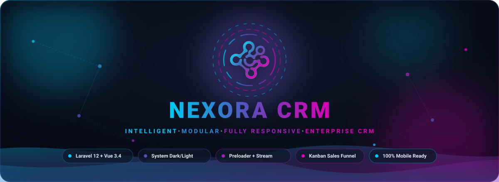
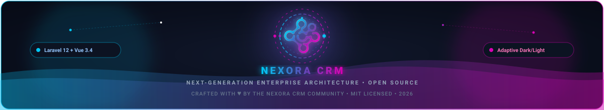

<div align="center">

<!-- Animated Header Interactive Banner (Self-contained vector SVG styled with Nexora Brand Gradient: Cyan #01C7F4 → Blue #2590D6 → Indigo #5A4DB9 → Violet #9E24B7 → Magenta #D803B3) -->
<a href="#-plain-english-summary">
  
</a>

<!-- Animated SVG Live Telemetry & License Ticker (Zero External Dependencies) -->
<div align="center">
  
</div>

<br/>

<!-- License & Commercial Badges (Matching Logo Colorway) -->
<p align="center">
  <a href="#-official-mit-license-text"></a>
  
  
  
  
  
  <a href="https://github.com/Isuru-CodeX/NoxusCRM"></a>
</p>

<!-- Quick Navigation Links -->
<p align="center">
  <a href="#-plain-english-summary"><b>🌟 Summary</b></a> •
  <a href="#-deep-dive-what-is-the-mit-license"><b>📖 About MIT</b></a> •
  <a href="#-rights-permissions--obligations"><b>⚖️ Permissions Matrix</b></a> •
  <a href="#-enterprise--commercial-adoption-guide"><b>🏢 Enterprise Guide</b></a> •
  <a href="#-open-source-license-comparison"><b>🆚 License Comparison</b></a> •
  <a href="#-frequently-asked-questions-faq"><b>❓ FAQ</b></a> •
  <a href="#-official-mit-license-text"><b>📜 Legal Text</b></a> •
  <a href="#-community--maintainers"><b>👥 Maintainers</b></a>
</p>

</div>

---

<!-- Animated Gradient Divider -->


## 🌟 Plain-English Summary

**Nexora** (NoxusCRM) is proudly licensed under the **MIT License**—one of the most liberal, business-friendly, and universally recognized open-source licenses ever authored.

Under this license, you are granted complete freedom to use, copy, modify, merge, publish, distribute, sublicense, and sell copies of Nexora, whether for personal experiments, commercial client deployments, or enterprise-scale infrastructure.

```
┌────────────────────────────────────────────────────────────────────────────────────────┐
│                              MIT License Core Tenets                                   │
├───────────────────┬───────────────────┬──────────────────────┬─────────────────────────┤
│ 💼 Commercial     │ 🛠️ Unlimited Code │ 🔒 Closed Modules    │ 🏷️ Simple Obligation    │
│    Freedom        │    Modifications  │    Allowed           │    (Attribution)        │
├───────────────────┼───────────────────┼──────────────────────┼─────────────────────────┤
│ • Zero seat fees  │ • Rewrite logic   │ • Proprietary addons │ • Keep copyright notice │
│ • Deploy SaaS     │ • Re-theme UI/UX  │ • Private deployment │ • Keep MIT license text │
│ • Charge clients  │ • Add custom APIs │ • No forced open-src │ • No warranty liability │
└───────────────────┴───────────────────┴──────────────────────┴─────────────────────────┘
```

---

<!-- Animated Gradient Divider -->


## 📖 Deep Dive: What is the MIT License?

The **MIT License** originated at the Massachusetts Institute of Technology in the late 1980s. It is an **OSI-approved** (Open Source Initiative) and **FSF-approved** (Free Software Foundation) permissive software license designed with a singular, powerful philosophy:

> *"Give programmers and organizations maximum possible freedom to innovate, while providing software authors with complete legal immunity from warranties or damages."*

### Key Hallmarks of the MIT License:

1. **Permissive, Non-Copyleft**: Unlike restrictive "copyleft" licenses (such as GPLv3 or AGPLv3), the MIT License does **not** infect your code. You are **never required** to open-source your own proprietary customizations, proprietary packages, or internal business workflows.
2. **Extreme Simplicity**: The entire legal text is approximately 170 words long. It contains no convoluted legal loopholes, patent minefields, or ambiguous definitions.
3. **Universally Trusted by Global Enterprises**: Major technology foundations—including Laravel, Vue.js, React, Node.js, Tailwind CSS, TypeScript, and Microsoft .NET—utilize the MIT License. Enterprise legal departments routinely approve MIT-licensed software without hesitation.
4. **Complete Data Sovereignty & Anti-Lock-In**: Traditional proprietary CRMs (Salesforce, HubSpot, Zoho, Microsoft Dynamics) charge exorbitant per-user monthly subscription fees and restrict data export. Nexora's MIT license guarantees you own your source code, your database, your infrastructure, and your customer relationships forever.

---

<!-- Animated Gradient Divider -->


## ⚖️ Rights, Permissions & Obligations

<table>
  <tr>
    <td width="33%" valign="top">
      <h3>✅ Permissions</h3>
      <p><em>What you are freely allowed to do:</em></p>
      <ul>
        <li><strong>Commercial Use:</strong> Deploy Nexora in revenue-generating enterprises, commercial applications, or provide paid managed hosting.</li>
        <li><strong>Modification:</strong> Alter, extend, refactor, rebrand, or completely rewrite any portion of the source code.</li>
        <li><strong>Distribution:</strong> Distribute the original or modified source code or compiled assets to third parties.</li>
        <li><strong>Sublicensing:</strong> Grant sublicenses to distribute or run the software under distinct, even proprietary, terms.</li>
        <li><strong>Private Use:</strong> Install and run Nexora across private intranets, isolated VPCs, or air-gapped data centers without publishing your modifications.</li>
      </ul>
    </td>
    <td width="33%" valign="top">
      <h3>📋 Conditions</h3>
      <p><em>What you are required to do:</em></p>
      <ul>
        <li><strong>Preserve Copyright Notice:</strong> Retain the original copyright notice (<code>Copyright (c) 2026 Nexora CRM Team</code>) in all copies or substantial portions of the Software.</li>
        <li><strong>Preserve License Text:</strong> Include the complete text of the MIT License alongside any redistribution of the source code.</li>
        <li><strong>Document Major Changes:</strong> While not legally enforced by MIT, documenting architecture changes helps maintain future upgrade compatibility.</li>
      </ul>
    </td>
    <td width="33%" valign="top">
      <h3>❌ Limitations</h3>
      <p><em>What is not granted or liable:</em></p>
      <ul>
        <li><strong>No Warranty:</strong> The Software is provided "AS IS", without warranty of any kind, express or implied (merchantability, fitness for purpose).</li>
        <li><strong>No Liability:</strong> Authors and copyright holders are not liable for any damages, data losses, operational downtimes, or financial claims arising from software use.</li>
        <li><strong>No Trademark Rights:</strong> Does not grant trademark rights to use the Nexora name, official logos, or brand marks for marketing derivative products.</li>
      </ul>
    </td>
  </tr>
</table>

> [!TIP]
> **Summary for Developers & CTOs:** You can use Nexora for anything, sell it to anyone, modify it however you want, and keep your custom modules closed-source. You only need to include the copyright notice in your source files and agree that the author cannot be sued if something breaks.

---

<!-- Animated Gradient Divider -->


## 🏢 Enterprise & Commercial Adoption Guide

To provide clarity for executive leadership, corporate procurement, and legal teams, here is how the MIT License applies to real-world deployment scenarios:

### 1. Digital Agencies & Systems Integrators
* **Scenario:** Your agency wants to build, customize, and deploy Nexora CRM for multiple paying enterprise clients.
* **Can you do this?** **Yes, 100%.** You can charge your clients for implementation, custom package engineering, cloud infrastructure setup, UI/UX theming, and ongoing maintenance.

### 2. White-Labeling & Reselling
* **Scenario:** You want to customize Nexora with your client's brand palette, company logos, and domain name.
* **Can you do this?** **Yes.** You are free to customize the user interface, logos, and styling. The only legal requirement is that the original copyright notice remains intact in the underlying source code files and license file.

### 3. Proprietary Add-on Modules & Plugins
* **Scenario:** You build a custom AI sales prediction module under `packages/YourCompany/AiPredictor` that uses proprietary algorithms.
* **Do you have to open-source your module?** **No.** Unlike GPL-licensed software, the MIT License allows you to distribute or sell your custom modules under proprietary, closed-source commercial licenses.

### 4. Managed SaaS & Cloud Hosting
* **Scenario:** You want to offer Nexora as a multi-tenant cloud SaaS service hosted on AWS, GCP, or DigitalOcean, charging monthly customer fees.
* **Can you do this?** **Yes.** Unlike AGPLv3 (which forces SaaS providers to make all server-side code modifications available over the network), the MIT License imposes zero restrictions on SaaS distribution.

### 5. Private Corporate Workstations & Air-Gapped Clouds
* **Scenario:** A healthcare, defense, or banking enterprise runs Nexora strictly inside an on-premise air-gapped network.
* **Are you required to publish internal changes?** **No.** You have zero obligation to share any code, modifications, or database schemas with anyone outside your organization.

---

<!-- Animated Gradient Divider -->


## 🆚 Open-Source License Comparison

How does the MIT License compare with other prominent software licenses in the CRM and enterprise software sector?

| License & Category | Commercial Use | Modify Source | Close-Source Derivatives | Network Copyleft (SaaS Trigger) | Patent Grant | Cost per Seat | Complete Data Sovereignty |
|:---|:---:|:---:|:---:|:---:|:---:|:---:|:---:|
| **MIT License (Nexora CRM)** | ✅ **Permitted** | ✅ **Permitted** | ✅ **Allowed** | ❌ **None** | Simple | **$0 / Unlimited** | ✅ **100% On-Premise / Cloud** |
| **Apache License 2.0** | ✅ Permitted | ✅ Permitted | ✅ Allowed | ❌ None | Explicit | $0 / Unlimited | ✅ 100% On-Premise / Cloud |
| **GNU GPLv3** | ✅ Permitted | ✅ Permitted | ❌ Forbidden (Copyleft) | ❌ None | Explicit | $0 / Unlimited | ✅ 100% On-Premise / Cloud |
| **GNU AGPLv3** | ✅ Permitted | ✅ Permitted | ❌ Forbidden (Copyleft) | ⚠️ **Forced Disclosure** | Explicit | $0 / Unlimited | ✅ 100% On-Premise / Cloud |
| **Proprietary SaaS (Salesforce/HubSpot)** | ❌ Restricted | ❌ No Access | ❌ Vendor Owned | ❌ Closed Vendor | Proprietary | **$150 - $350 / mo / user** | ❌ Vendor Cloud Lock-In |

---

<!-- Animated Gradient Divider -->


## ❓ Frequently Asked Questions (FAQ)

### Q1: Do I have to pay any royalties or licensing fees to the author?
**No.** The MIT License grants rights completely free of charge. You will never be billed for user seats, pipeline volume, contact counts, or API requests by Nexora CRM.

### Q2: What happens if I bundle Nexora with third-party Composer packages?
Nexora's core modular architecture is designed so each package can declare its own dependencies cleanly via `composer.json`. Because MIT is compatible with nearly all standard open-source licenses (BSD, Apache 2.0, ISC), combining them presents no legal conflict.

### Q3: Where do I need to preserve the copyright notice?
You must ensure the copyright notice and MIT license text remain present in the project's root directory (`LICENSE` / `LICENSE.md`) and within the headers of source code files where attribution exists. You do not need to display the license text on your customer-facing web login screens.

### Q4: Can I contribute my code back to Nexora?
**Yes!** We welcome community contributions. By submitting a pull request to the Nexora repository, you agree that your contributions will be licensed under the same MIT License, ensuring the entire community benefits from continuous improvements.

### Q5: Does the MIT License protect me from patent claims?
The MIT License text does not contain an express patent grant (unlike Apache 2.0), but under copyright law, it grants an unrestricted, royalty-free license to use, modify, and distribute the software as delivered.

---

<!-- Animated Gradient Divider -->


## 📜 Official MIT License Text

Below is the official, legally binding text of the MIT License governing the **Nexora** (NoxusCRM) codebase:

```text
MIT License

Copyright (c) 2026 Nexora CRM Team (https://github.com/Isuru-CodeX/NoxusCRM)

Permission is hereby granted, free of charge, to any person obtaining a copy
of this software and associated documentation files (the "Software"), to deal
in the Software without restriction, including without limitation the rights
to use, copy, modify, merge, publish, distribute, sublicense, and/or sell
copies of the Software, and to permit persons to whom the Software is
furnished to do so, subject to the following conditions:

The above copyright notice and this permission notice shall be included in all
copies or substantial portions of the Software.

THE SOFTWARE IS PROVIDED "AS IS", WITHOUT WARRANTY OF ANY KIND, EXPRESS OR
IMPLIED, INCLUDING BUT NOT LIMITED TO THE WARRANTIES OF MERCHANTABILITY,
FITNESS FOR A PARTICULAR PURPOSE AND NONINFRINGEMENT. IN NO EVENT SHALL THE
AUTHORS OR COPYRIGHT HOLDERS BE LIABLE FOR ANY CLAIM, DAMAGES OR OTHER
LIABILITY, WHETHER IN AN ACTION OF CONTRACT, TORT OR OTHERWISE, ARISING FROM,
OUT OF OR IN CONNECTION WITH THE SOFTWARE OR THE USE OR OTHER DEALINGS IN THE
SOFTWARE.
```

---

<!-- Animated Gradient Divider -->


## 🌐 Community & Maintainers

<div align="center">

### **Nexora CRM Open-Source Core Team**
*Enterprise-Grade Autonomous Customer Relationship Management*

<br/>

<!-- Community Links -->
<a href="https://github.com/Isuru-CodeX/NoxusCRM"></a>
<a href="https://github.com/Isuru-CodeX/NoxusCRM/issues"></a>
<a href="https://github.com/Isuru-CodeX/NoxusCRM/discussions"></a>
<a href="https://github.com/Isuru-CodeX/NoxusCRM/security"></a>

<br/><br/>

⭐ **If you find Nexora CRM helpful, give it a star on GitHub!** ⭐

<br/>

<a href="#-plain-english-summary"><b>⬆️ Back to Top</b></a>

<br/><br/>

</div>

---

<div align="center">

<!-- Animated Footer Interactive Banner (Self-contained vector SVG with Nexora Brand Gradient: Cyan #01C7F4 → Blue #2590D6 → Indigo #5A4DB9 → Violet #9E24B7 → Magenta #D803B3) -->
<a href="#-plain-english-summary">
  
</a>

</div>

