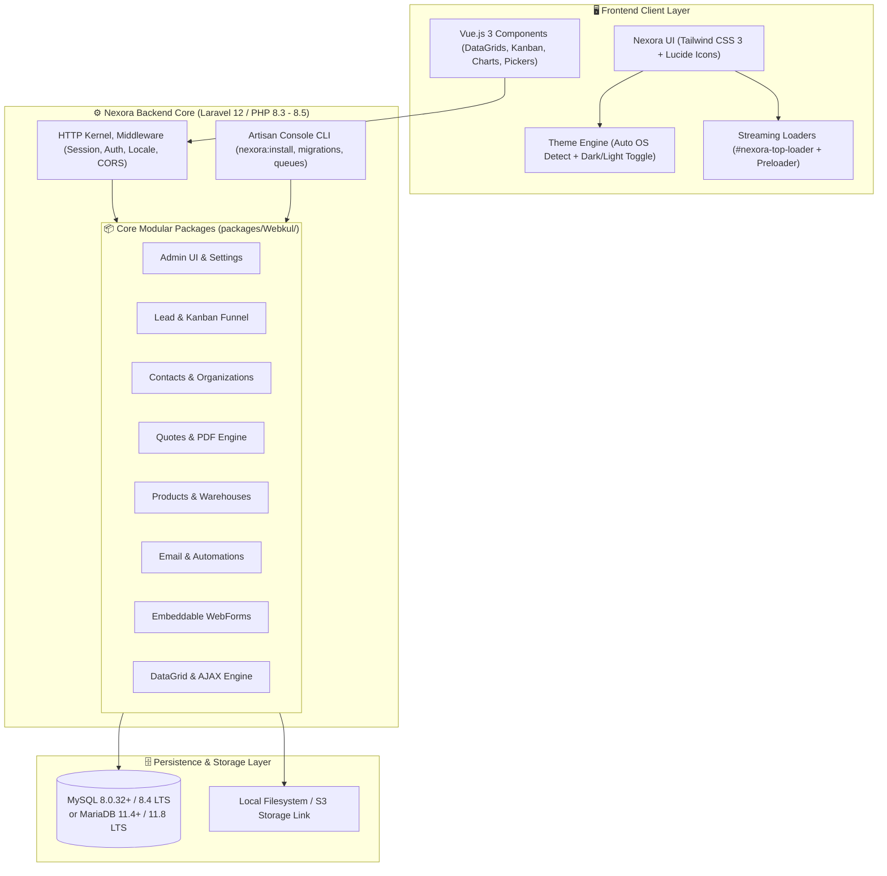
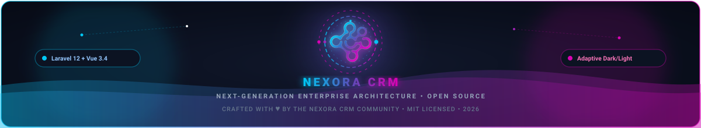

<div align="center">

<!-- Animated Header Interactive Banner (Self-contained vector SVG styled with Nexora Brand Gradient: Cyan #01C7F4 → Blue #2590D6 → Indigo #5A4DB9 → Violet #9E24B7 → Magenta #D803B3) -->
<a href="#-key-features--uiux-innovations">
  
</a>

<!-- Responsive Brand Logo (GitHub Dark / Light Adaptive via fragment hashes) -->
<p align="center">
  <a href="https://github.com/Isuru-CodeX/NoxusCRM">
    
    
  </a>
</p>

<!-- Animated SVG Live Telemetry & Feature Status Ticker (Zero External Dependencies) -->
<p align="center">
  
</p>

<br/>

<!-- Core Technology Stack Badges (Matching Logo Colorway) -->
<p align="center">
  <a href="https://php.net"></a>
  <a href="https://laravel.com"></a>
  <a href="https://vuejs.org"></a>
  <a href="https://tailwindcss.com"></a>
  <a href="https://vitejs.dev"></a>
  <a href="https://www.mysql.com"></a>
</p>

<!-- Repository Metrics & Quality Badges -->
<p align="center">
  
  
  <a href="https://github.com/Isuru-CodeX/NoxusCRM/stargazers"></a>
  <a href="https://github.com/Isuru-CodeX/NoxusCRM/network/members"></a>
  
  <a href="LICENSE"></a>
</p>

<!-- Quick Navigation Links -->
<p align="center">
  <a href="#-overview"><b>🌟 Overview</b></a> •
  <a href="#-key-features--uiux-innovations"><b>✨ Features</b></a> •
  <a href="#-uiux-engineering-highlights"><b>🎨 UI/UX System</b></a> •
  <a href="#-modular-architecture"><b>🏛️ Architecture</b></a> •
  <a href="#-tech-stack--tools"><b>🛠️ Tech Stack</b></a> •
  <a href="#-system-requirements"><b>💻 Requirements</b></a> •
  <a href="#-software-downloads"><b>📥 Downloads</b></a> •
  <a href="#-quick-start--installation"><b>🚀 Quick Start</b></a> •
  <a href="#-completed-milestones--roadmap"><b>🗺️ Roadmap</b></a> •
  <a href="#-production-deployment"><b>🌐 Deployment</b></a> •
  <a href="#-author--connect"><b>👨‍💻 Author</b></a>
</p>

</div>

---

<!-- Animated Gradient Divider -->


## 🌟 Overview

**Nexora** (NoxusCRM) is an enterprise-grade, open-source Customer Relationship Management (CRM) ecosystem engineered for growing businesses, high-velocity sales teams, and modern enterprises seeking complete data sovereignty, zero seat licensing fees, and an ultra-modern user experience.

Crafted around a custom multi-stop gradient identity (**`#01C7F4`** Cyan $\rightarrow$ **`#2590D6`** Blue $\rightarrow$ **`#5A4DB9`** Indigo $\rightarrow$ **`#9E24B7`** Violet $\rightarrow$ **`#D803B3`** Magenta), Nexora combines high-throughput Laravel 12 backend operations with an interactive Vue.js 3 / Tailwind CSS frontend:

```
┌────────────────────────────────────────────────────────────────────────────────────────┐
│                              Nexora CRM Command Highlights                             │
├───────────────────┬───────────────────┬──────────────────────┬─────────────────────────┤
│ 🌗 Theme Engine   │ ⏳ Streaming UX   │ 📱 Responsive Frame  │ 📊 Sales Mastery        │
├───────────────────┼───────────────────┼──────────────────────┼─────────────────────────┤
│ • Zero-FOUC Paint │ • Branded Spinner │ • Glassmorphic Nav   │ • Drag & Drop Kanban    │
│ • OS Auto-Detect  │ • #nexora-top-bar │ • Mobile Touch Drawer│ • Dynamic PDF Quotes    │
│ • Cookie & State  │ • Action Overlays │ • Smooth DataGrids   │ • Two-Way Email Sync    │
│ • Instant Switch  │ • Shimmer Sheen   │ • 44px Touch Targets │ • Granular RBAC & EAV   │
└───────────────────┴───────────────────┴──────────────────────┴─────────────────────────┘
```

---

<!-- Animated Gradient Divider -->


## ✨ Key Features & UI/UX Innovations

<table>
  <tr>
    <td width="50%">
      <h3>🌗 System-Aware Dark &amp; Light Mode</h3>
      <ul>
        <li><strong>Zero White Flash (FOUC):</strong> Instantaneous inline OS evaluation (<code>prefers-color-scheme</code>) executes before first paint to eliminate glaring screen flashes.</li>
        <li><strong>Universal Switcher:</strong> Switch seamlessly between Dark &amp; Light mode anywhere—top header, login cards, and the web installer wizard.</li>
        <li><strong>Dual-Layer Persistence:</strong> Synchronized across <code>localStorage</code> and secure HTTP cookies for server-side layout consistency.</li>
      </ul>
    </td>
    <td width="50%">
      <h3>⏳ Branded Page Preloader &amp; Route Progress Stream</h3>
      <ul>
        <li><strong>Orbital Preloader:</strong> Centered Nexora emblem with a multi-stop rotating orbital gradient spinner and progress bar.</li>
        <li><strong>Top Route Bar (<code>#nexora-top-loader</code>):</strong> Ultra-sleek 3px glowing gradient line across the viewport header providing instantaneous feedback for link navigation and AJAX DataGrids.</li>
        <li><strong>Action Loader (<code>&lt;v-nexora-action-loader&gt;</code>):</strong> Frosted glass backdrop blur overlay for heavy exports, batch uploads, and pipeline updates.</li>
      </ul>
    </td>
  </tr>
  <tr>
    <td width="50%">
      <h3>📱 100% Mobile &amp; Tablet Responsive</h3>
      <ul>
        <li><strong>Glassmorphic Sticky Nav:</strong> Translucent top navigation bar with <code>backdrop-blur-md</code>, high-contrast borders, and ergonomic spacing.</li>
        <li><strong>Touch Drawer:</strong> Silky sliding mobile drawer sidebar with minimum 44px tactile tap boundaries.</li>
        <li><strong>Adaptive DataGrids:</strong> Responsive tables engineered with contained horizontal scrolling to keep master layouts intact on small screens.</li>
      </ul>
    </td>
    <td width="50%">
      <h3>💫 Fluid Micro-Interactions &amp; Physics</h3>
      <ul>
        <li><strong>Tactile Press Feedback:</strong> Buttons feature subtle physics-driven press scaling (<code>active:scale-[0.97]</code>) and glowing hover elevation.</li>
        <li><strong>Luminescent Skeletons:</strong> Enhanced <code>.shimmer</code> loaders featuring subtle cyan-to-violet sheen gradients.</li>
        <li><strong>Brand Input Glow Rings:</strong> Focused input fields illuminate with crisp dual-mode accent glow boundaries.</li>
      </ul>
    </td>
  </tr>
  <tr>
    <td width="50%">
      <h3>📊 Visual Sales Pipeline &amp; Kanban Funnel</h3>
      <ul>
        <li><strong>Interactive Kanban:</strong> Drag-and-drop lead cards smoothly across custom sales stages.</li>
        <li><strong>Deal Valuation:</strong> Real-time stage velocity, lead valuations, and win/loss conversion statistics.</li>
        <li><strong>Embeddable WebForms:</strong> Generate embeddable HTML lead capture forms with custom field routing directly into your sales pipeline.</li>
      </ul>
    </td>
    <td width="50%">
      <h3>✉️ Communications &amp; Dynamic Quote Automation</h3>
      <ul>
        <li><strong>Unified Email Client:</strong> Two-way IMAP/SMTP mail integration with rich-text templates and threaded replies.</li>
        <li><strong>Quotes &amp; Invoices:</strong> Dynamic quote calculation engine with instant PDF generation and email dispatch.</li>
        <li><strong>Granular RBAC:</strong> Role-based access control, organizational divisions, and automated workflow triggers.</li>
      </ul>
    </td>
  </tr>
</table>

---

<!-- Animated Gradient Divider -->


## 🎨 UI/UX Engineering Highlights

<!-- Live Streaming HUD Equalizer Animation (Styled in Logo Cyan #01C7F4) -->
<div align="center">


</div>

<br/>

```
   [User Request] ──► [OS Dark/Light Sensor] ──► [Zero-FOUC Root Class Applied]
           │
           ├──► [Page Preloader Orbit Animation] ──► [Initial DOM Mounted]
           │
           └──► [Route/AJAX Click] ──► [#nexora-top-loader Glowing Stream 0% → 100%]
```

* **Tailwind CSS 3 + Brand Palette Utilities**: Built with custom tokens mapped to the Nexora colorway:
  - 🌐 **Cyan**: `#01C7F4` (Primary Glow & Accent Badges)
  - 🌊 **Blue**: `#2590D6` (Secondary Action & Buttons)
  - 🔮 **Indigo**: `#5A4DB9` (Navigation Headers & Surfaces)
  - 💜 **Violet**: `#9E24B7` (Badges, Active Tabs & Borders)
  - 🌸 **Magenta**: `#D803B3` (Hover Highlighters & Gradients)
* **Zero Flash of Unstyled Content (FOUC)**: Head-injected theme detection script prevents flickering when loading pages on dark-mode devices.
* **Component-Level Vue.js 3 Telemetry**: Reactive data bindings allow instant stage changes, live search filter queries, and real-time form validation.

---

<!-- Animated Gradient Divider -->


## 📊 Sales Pipeline & Kanban Funnel

<!-- Live Kanban Pipeline Ticker (Styled in Logo Violet #9E24B7) -->
<div align="center">


</div>

<br/>

Nexora gives sales leadership real-time visibility into every deal:

* **Drag-and-Drop Stages**: Smooth velocity transitions across customizable pipeline stages (*New, Prospect, Contacted, Qualified, Proposal Sent, Closed Won, Closed Lost*).
* **Multi-Currency Deal Valuation**: Instant aggregate currency sums per stage with dynamic exchange rate recalculation.
* **Rotting Deal Alerts**: Visual indicators flag leads that have remained stagnant in a stage past their configured threshold.
* **WebForm Lead Ingestion**: One-click embeddable forms that capture inbound leads directly into target pipeline stages without third-party form SaaS.

---

<!-- Animated Gradient Divider -->


## 🏛️ Modular Architecture

Nexora follows a decoupled modular package design located under `packages/Webkul/`, allowing high maintainability, upgrade safety, and limitless extensibility:



### 📦 Modular Package Directory

| Package | Purpose & Capabilities |
|---|---|
| **`packages/Webkul/Admin`** | Master administrator portal, theme engine, loaders, dashboard analytics, and UI components. |
| **`packages/Webkul/Lead`** | Visual Kanban sales funnel, pipeline stages, lead sources, and deal conversions. |
| **`packages/Webkul/Contact`** | Customer directory, individual persons, organizations, and communication histories. |
| **`packages/Webkul/Quote`** | Dynamic quote calculation, discount rules, tax computation, and automated PDF export. |
| **`packages/Webkul/Product`** | Product catalog, pricing structures, inventory tracking, and warehouse mapping. |
| **`packages/Webkul/Email`** | Two-way IMAP/SMTP client, email templates, and automated inbound synchronization. |
| **`packages/Webkul/WebForm`** | Drag-and-drop webform builder for embedding lead capture directly into external websites. |
| **`packages/Webkul/DataGrid`** | High-performance tabular data engine with sorting, column filtering, and bulk exports. |
| **`packages/Webkul/Automation`** | Event-driven workflow rules, trigger mechanisms, and email dispatch routines. |
| **`packages/Webkul/Installer`** | 5-step automated web installer wizard for seamless initial platform configuration. |

---

<!-- Animated Gradient Divider -->


## 🛠️ Tech Stack & Tools

<div align="center">


</div>

<br/>

| Tier | Technology | Purpose & Specifications |
|:---|:---|:---|
| **Backend Framework** | **Laravel 12.x** | Modern PHP framework with route caching, queues, events, and Eloquent ORM. |
| **PHP Runtime** | **PHP 8.3 / 8.4 / 8.5** | High-performance PHP with typed properties, JIT, and opcode optimizations. |
| **Frontend Framework** | **Vue.js 3.4** | Progressive JavaScript framework powering DataGrids, Kanban boards, and modal dialogs. |
| **Styling & Design** | **Tailwind CSS 3.x** | Utility-first CSS engine customized with Nexora's signature gradient tokens. |
| **Build Toolchain** | **Vite 5.x** | Sub-second HMR and optimized multi-bundle production compiling. |
| **Primary Database** | **MySQL 8.4 LTS / MariaDB 11.8 LTS** | ACID-compliant relational data store with optimized JSON and indexing support. |
| **Testing Suite** | **Pest 3.x / PHPUnit 11** | Expressive PHP testing framework ensuring zero-regression code quality. |
| **Code Formatter** | **Laravel Pint** | Opinionated PSR-12 code style fixer for clean, consistent PHP code. |

---

<!-- Animated Gradient Divider -->


## 💻 System Requirements

Please ensure your server or development workstation satisfies the following requirements:

| Component | Minimum Requirement | Recommended Specification |
| :--- | :--- | :--- |
| **Web Server** | Apache 2.4+ or NGINX 1.20+ | **NGINX 1.24+** or **Apache 2.4+** |
| **Operating System** | Windows 10/11, macOS 12+, Ubuntu 22.04+ | **Linux (Ubuntu 24.04 LTS / Debian 12)** |
| **System RAM** | 3 GB RAM | **4 GB – 8 GB RAM** |
| **PHP Version** | **PHP 8.3** | **PHP 8.3 / 8.4 / 8.5** |
| **Composer** | Composer 2.5+ | **Composer 2.8+** |
| **MySQL** *(Option A)* | MySQL 8.0.32+ | **MySQL 8.4 LTS** |
| **MariaDB** *(Option B)* | MariaDB 11.4 LTS+ | **MariaDB 11.8 LTS** |
| **Node.js & npm** | Node.js 18.x LTS / npm 9+ | **Node.js 20.x or 22.x LTS** |
| **Git** | Git 2.30+ | **Git 2.45+** |

### Required PHP Extensions

Ensure the following extensions are enabled in your active `php.ini`:

```ini
extension=bcmath
extension=curl
extension=fileinfo
extension=gd
extension=intl
extension=mbstring
extension=openssl
extension=pdo_mysql
extension=zip
```

> [!IMPORTANT]
> The `gd` and `fileinfo` extensions are mandatory for generating dynamic PDF quotes and processing spreadsheet imports. Verify with:
> ```powershell
> php -m | Select-String "gd|fileinfo|pdo_mysql|zip|intl"
> ```

---

<!-- Animated Gradient Divider -->


## 📥 Software Downloads

<details>
<summary><strong>1. Git (Version Control)</strong></summary>

* **Official Portal:** [git-scm.com/downloads](https://git-scm.com/downloads)
* **Windows (WinGet):**
  ```powershell
  winget install Git.Git --source winget
  ```
* **macOS (Homebrew):**
  ```bash
  brew install git
  ```
* **Linux (Ubuntu/Debian):**
  ```bash
  sudo apt update && sudo apt install -y git
  ```
* **Verify:** `git --version`
</details>

<details>
<summary><strong>2. PHP 8.3, 8.4 or 8.5</strong></summary>

* **Official Portal:** [php.net/downloads](https://www.php.net/downloads.php)
* **Windows (WinGet):**
  ```powershell
  # Install PHP 8.3
  winget install PHP.PHP.8.3 --source winget --accept-source-agreements

  # Or install latest PHP 8.5
  winget install PHP.PHP.8.5 --source winget --accept-source-agreements
  ```
  *Alternative Windows Environments:* [Laravel Herd for Windows](https://herd.laravel.com/windows) or [Laragon](https://laragon.org/download/).
* **macOS (Homebrew):**
  ```bash
  brew install php@8.3
  brew link --force --overwrite php@8.3
  ```
* **Linux (Ubuntu/Debian via ondrej/php PPA):**
  ```bash
  sudo apt update && sudo apt install -y software-properties-common
  sudo add-apt-repository ppa:ondrej/php -y
  sudo apt update
  sudo apt install -y php8.3 php8.3-cli php8.3-fpm php8.3-mysql php8.3-xml php8.3-mbstring php8.3-curl php8.3-zip php8.3-gd php8.3-intl php8.3-bcmath
  ```
* **Verify:** `php -v`
</details>

<details>
<summary><strong>3. Composer 2.5+ (PHP Dependency Manager)</strong></summary>

* **Official Portal:** [getcomposer.org/download](https://getcomposer.org/download/)
* **Windows:** Download and execute [Composer-Setup.exe](https://getcomposer.org/Composer-Setup.exe).
* **macOS / Linux:**
  ```bash
  php -r "copy('https://getcomposer.org/installer', 'composer-setup.php');"
  php composer-setup.php --install-dir=/usr/local/bin --filename=composer
  php -r "unlink('composer-setup.php');"
  ```
* **Verify:** `composer --version`
</details>

<details>
<summary><strong>4. Database: MySQL 8.4 LTS OR MariaDB 11.8 LTS</strong></summary>

Choose either MySQL or MariaDB:

* **MySQL 8.4 LTS (Recommended):**
  - Download: [dev.mysql.com/downloads/mysql](https://dev.mysql.com/downloads/mysql/)
  - WinGet:
    ```powershell
    winget install Oracle.MySQL --source winget
    ```
* **MariaDB 11.8 LTS (Alternative):**
  - Download: [mariadb.org/download](https://mariadb.org/download/)
  - WinGet:
    ```powershell
    winget install MariaDB.Server --source winget
    ```
* Create the target database:
  ```sql
  CREATE DATABASE nexora_crm CHARACTER SET utf8mb4 COLLATE utf8mb4_unicode_ci;
  ```
</details>

<details>
<summary><strong>5. Node.js &amp; npm (Frontend Toolchain)</strong></summary>

* **Official Portal:** [nodejs.org](https://nodejs.org/en/download) (Select **20.x LTS** or **22.x LTS**)
* **macOS:** `brew install node`
* **Linux:** Install via [NodeSource Distributions](https://github.com/nodesource/distributions)
* **Verify:** `node -v` and `npm -v`
</details>

<details>
<summary><strong>6. Web Server (Apache 2 or NGINX)</strong></summary>

* **Apache 2:**
  - Official Download: [httpd.apache.org](https://httpd.apache.org/download.cgi)
  - Ubuntu/Debian: `sudo apt install -y apache2 libapache2-mod-php8.3 && sudo a2enmod rewrite`
* **NGINX:**
  - Official Download: [nginx.org](https://nginx.org/en/download.html)
  - Ubuntu/Debian: `sudo apt install -y nginx`
</details>

---

<!-- Animated Gradient Divider -->


## 🚀 Quick Start & Installation

<!-- Terminal Animated Command Stream (Styled in Logo Blue #2590D6) -->
<div align="center">


</div>

<br/>

### Step 1: Clone the Repository

```bash
git clone https://github.com/Isuru-CodeX/NoxusCRM.git
cd NoxusCRM
```

### Step 2: Install PHP Dependencies

```bash
composer install
```

### Step 3: Configure Environment (`.env`)

Copy the template and generate the application encryption key:

```bash
# Windows PowerShell
Copy-Item .env.example .env

# macOS / Linux
cp .env.example .env

# Generate application security key
php artisan key:generate
```

Open `.env` in your editor and configure your database parameters:

```env
APP_NAME='Nexora'
APP_ENV=local
APP_DEBUG=true
APP_URL=http://127.0.0.1:8000

DB_CONNECTION=mysql        # or mariadb
DB_HOST=127.0.0.1
DB_PORT=3306               # adjust if using an alternate port
DB_DATABASE=nexora_crm
DB_USERNAME=root
DB_PASSWORD=your_secure_password
```

### Step 4: Compile Frontend Assets (Vite)

Compile all 4 frontend modules using Vite and Tailwind CSS:

```bash
# 1. Root application bundle
npm install
npm run build

# 2. Admin UI bundle (theme engine, loaders, animations, charts)
cd packages/Webkul/Admin
npm install
npm run build
cd ../../..

# 3. Web Installer bundle
cd packages/Webkul/Installer
npm install
npm run build
cd ../../..

# 4. WebForm bundle
cd packages/Webkul/WebForm
npm install
npm run build
cd ../../..
```

> [!TIP]
> On Windows PowerShell, you can skip optional Playwright browser binaries by running:
> ```powershell
> $env:PLAYWRIGHT_SKIP_BROWSER_DOWNLOAD="1"
> ```

### Step 5: Run the Automated Artisan Installer

Run the interactive installation command to migrate database tables, seed default sales stages and pipelines, and create your super-administrator account:

```bash
php artisan nexora:install
```

*(Note: For backward compatibility, `php artisan krayin-crm:install` is also fully supported.)*

---

<!-- Animated Gradient Divider -->


## 🏃 Running Nexora

### Local Development Server

1. Flush stale application caches:
   ```bash
   php artisan optimize:clear
   ```

2. Boot the PHP development server:
   ```bash
   php artisan serve
   ```

3. Navigate in your browser:
   * **Admin Command Center:** [http://127.0.0.1:8000/admin/login](http://127.0.0.1:8000/admin/login)
   * **Web Installer Wizard:** [http://127.0.0.1:8000](http://127.0.0.1:8000) *(shown if database is unseeded)*

4. *(Optional — Live Frontend Dev Mode)* If actively modifying Admin Vue/Tailwind components:
   ```bash
   cd packages/Webkul/Admin
   npm run dev
   ```

---

<!-- Animated Gradient Divider -->


## 🔑 Default Credentials

If you seeded the database with default demo credentials:

| Field | Default Value | Description |
| :--- | :--- | :--- |
| **Login URL** | `http://127.0.0.1:8000/admin/login` | Administrator Portal |
| **Email** | `admin@example.com` | Super Administrator |
| **Password** | `admin123` | Default seed credential |

> [!WARNING]
> Change the default administrator credentials immediately upon logging in via **Settings → Users** before deploying to any public or production network.

---

<!-- Animated Gradient Divider -->


## 🗺️ Completed Milestones & Roadmap

- [x] **Zero-Flash System-Aware Dark & Light Mode Engine** (Instant inline OS detection)
- [x] **Branded Multi-Stop Orbital Page Preloader with Spinning Logo Emblem**
- [x] **Ultra-Sleek Top Route Progress Streaming Line (`#nexora-top-loader`)**
- [x] **Blurred Backdrop Action Loader (`<v-nexora-action-loader>`) for Heavy Exports**
- [x] **100% Mobile & Tablet Adaptive Frame with Glassmorphic Sticky Header**
- [x] **Silky Sliding Touch Drawer Sidebar with 44px Minimum Tap Targets**
- [x] **Interactive Drag-and-Drop Kanban Sales Pipeline with Stage Velocity**
- [x] **Dynamic Quotation Calculation Engine with Automated PDF Generation**
- [x] **Unified Two-Way IMAP/SMTP Email Client with WYSIWYG Templates**
- [x] **Granular Role-Based Access Control (RBAC) & Permission Matrices**
- [x] **Dynamic EAV (Entity-Attribute-Value) Custom Field Modeling Engine**
- [x] **Embeddable WebForm Generator with Automatic Funnel Stage Routing**
- [x] **5-Step Web Installer Wizard with Real-Time Server Environment Checks**
- [x] **4-Bundle Vite 5 & Tailwind CSS Multi-Module Asset Compilation Pipeline**
- [x] **Pest 3.x & PHPUnit 11 Automated Feature & Unit Test Suite**
- [ ] AI Sales Copilot for automated lead scoring and sentiment classification
- [ ] WhatsApp & Multi-Channel Customer Messaging Gateway
- [ ] Webhook Event Subscriptions & Zapier/Make Integration Hub

---

<!-- Animated Gradient Divider -->


## 🌐 Production Deployment

### 1. Optimize Laravel Caches

```bash
composer install --no-dev --optimize-autoloader
php artisan config:cache
php artisan route:cache
php artisan view:cache
php artisan storage:link
```

Ensure `.env` has:
```env
APP_ENV=production
APP_DEBUG=false
```

### 2. Apache 2 Configuration (`VirtualHost`)

Ensure `DocumentRoot` points strictly to the `public/` directory:

```apache
<VirtualHost *:80>
    ServerName crm.yourdomain.com
    DocumentRoot /var/www/nexora/public

    <Directory /var/www/nexora/public>
        AllowOverride All
        Require all granted
        Options -Indexes +FollowSymLinks
    </Directory>

    ErrorLog ${APACHE_LOG_DIR}/nexora_error.log
    CustomLog ${APACHE_LOG_DIR}/nexora_access.log combined
</VirtualHost>
```

Enable Apache `rewrite` and restart:
```bash
sudo a2enmod rewrite
sudo systemctl restart apache2
```

### 3. NGINX Configuration

```nginx
server {
    listen 80;
    server_name crm.yourdomain.com;
    root /var/www/nexora/public;

    add_header X-Frame-Options "SAMEORIGIN";
    add_header X-Content-Type-Options "nosniff";
    add_header X-XSS-Protection "1; mode=block";

    index index.php;
    charset utf-8;

    location / {
        try_files $uri $uri/ /index.php?$query_string;
    }

    location = /favicon.ico { access_log off; log_not_found off; }
    location = /robots.txt  { access_log off; log_not_found off; }

    error_page 404 /index.php;

    location ~ \.php$ {
        fastcgi_pass unix:/var/run/php/php8.3-fpm.sock;
        fastcgi_param SCRIPT_FILENAME $realpath_root$fastcgi_script_name;
        include fastcgi_params;
        fastcgi_hide_header X-Powered-By;
    }

    location ~ /\.(?!well-known).* {
        deny all;
    }
}
```

---

<!-- Animated Gradient Divider -->


## 🧪 Testing & Code Standards

```bash
# Execute the Pest & PHPUnit test suite
php artisan test --compact

# Automatically format code to PSR-12 standard via Laravel Pint
./vendor/bin/pint

# Run frontend unit & integration tests
npm run test:js
```

---

<!-- Animated Gradient Divider -->


## 🛡️ Security Vulnerabilities

If you discover any security vulnerability within Nexora, please review [SECURITY.md](SECURITY.md) and report it privately via email rather than posting to public issue trackers.

---

<!-- Animated Gradient Divider -->


## 👨‍💻 Author & Connect

<div align="center">

### **Isuru Rathnayaka**
*Full-Stack Software Engineer & AI Builder*

<br/>

<!-- Profile Views & Socials -->

<a href="https://github.com/Isuru-CodeX?tab=followers"></a>
<a href="https://www.linkedin.com/in/isuru-rathnayaka-220484288/"></a>
<a href="mailto:isururathnayaka999@gmail.com"></a>
<a href="https://github.com/Isuru-CodeX"></a>

<br/><br/>

⭐ **If you find Nexora CRM helpful, give it a star on GitHub!** ⭐

<br/>

<a href="#-overview"><b>⬆️ Back to Top</b></a>

<br/><br/>

</div>

---

## 📄 License

**Nexora (NoxusCRM)** is open-source software distributed under the [MIT License](LICENSE).  
Copyright &copy; 2026 **Isuru Rathnayaka (Nexora CRM)**. All rights reserved.

<div align="center">

<!-- Animated Footer Interactive Banner (Self-contained vector SVG with Nexora Brand Gradient: Cyan #01C7F4 → Blue #2590D6 → Indigo #5A4DB9 → Violet #9E24B7 → Magenta #D803B3) -->
<a href="#-overview">
  
</a>

</div>
