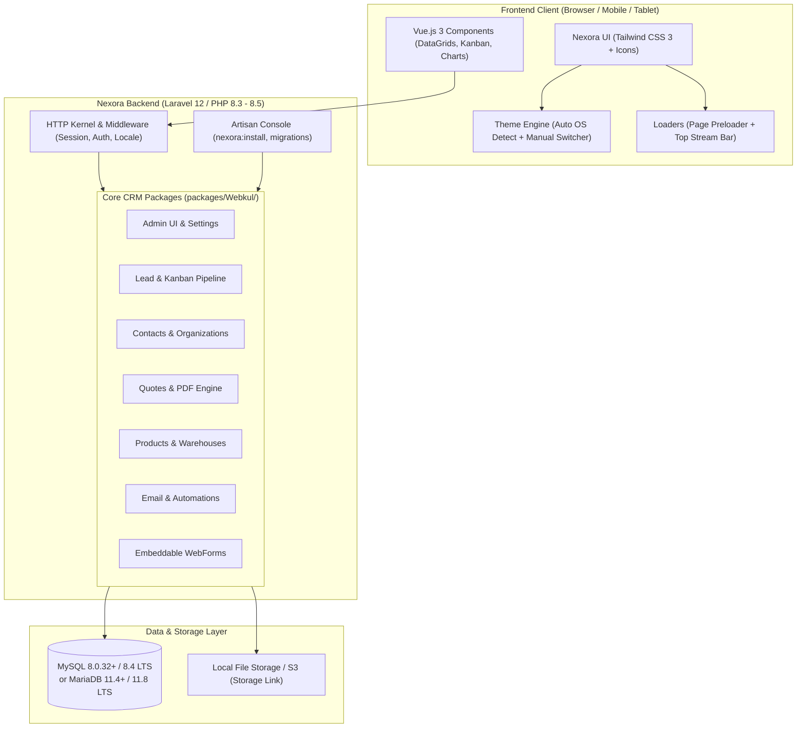

<p align="center">
  <picture>
    <source media="(prefers-color-scheme: dark)" srcset="public/images/nexora-logo-dark.png">
    <source media="(prefers-color-scheme: light)" srcset="public/images/nexora-logo-light.png">
    
  </picture>
</p>

<h3 align="center">
  <strong>Intelligent, Modular &amp; Fully Responsive Open-Source CRM Platform</strong>
</h3>

<p align="center">
  Built with <strong>Laravel 12 (PHP 8.3 - 8.5)</strong>, <strong>Vue.js 3</strong>, and <strong>Tailwind CSS</strong>.<br>
  Featuring zero-flash <strong>System-Aware Dark/Light Mode</strong>, <strong>Branded Page Preloaders</strong>, <strong>Top Route Progress Streaming</strong>, and <strong>Smooth Fluid Animations</strong>.
</p>

<p align="center">
  <a href="https://php.net"></a>
  <a href="https://laravel.com"></a>
  <a href="https://vuejs.org"></a>
  <a href="https://tailwindcss.com"></a>
  <a href="https://vitejs.dev"></a>
  <a href="LICENSE"></a>
</p>

<p align="center">
  <a href="#-key-features--uiux">✨ Features</a> •
  <a href="#-system-requirements">💻 Requirements</a> •
  <a href="#-step-by-step-software-downloads">📥 Software Downloads</a> •
  <a href="#-quick-start--installation">🚀 Installation</a> •
  <a href="#-architecture">🏛️ Architecture</a> •
  <a href="#-production-server-deployment">🌐 Web Servers</a> •
  <a href="#-admin-credentials">🔑 Default Login</a>
</p>

---

## 🌟 Overview

**Nexora** is a high-performance, open-source Customer Relationship Management (CRM) system designed for businesses, teams, and enterprises that demand complete control over their sales pipeline, customer relationships, quotes, and communications.

Crafted around a custom cyan-indigo-magenta identity (`#01C7F4` → `#2590D6` → `#5A4DB9` → `#9E24B7` → `#D803B3`), Nexora provides an engaging UI packed with **system-aware theme switching**, **branded loading screens**, **instant AJAX route feedback**, **fluid micro-interactions**, and **100% mobile-adaptive layouts**.

---

## ✨ Key Features & UI/UX

<table>
  <tr>
    <td width="50%">
      <h3>🌗 System-Aware Dark &amp; Light Mode</h3>
      <ul>
        <li><strong>Automatic OS Detection:</strong> Automatically senses device theme preference (<code>prefers-color-scheme</code>) before first paint—zero white flash (FOUC).</li>
        <li><strong>Manual Switcher:</strong> Instantly toggle between Dark &amp; Light mode anywhere (top navigation, login cards, web installer).</li>
        <li><strong>Persistent:</strong> Choices are remembered across sessions in <code>localStorage</code> and secure cookies.</li>
      </ul>
    </td>
    <td width="50%">
      <h3>⏳ Branded Page Preloader &amp; Top Progress Stream</h3>
      <ul>
        <li><strong>Page Preloader:</strong> Centered Nexora mark with rotating gradient orbital spinner and streaming progress bar for first loads.</li>
        <li><strong>Top Route Bar (<code>#nexora-top-loader</code>):</strong> Slim 3px glowing gradient bar across the viewport header giving instant feedback on route clicks and DataGrid AJAX requests.</li>
        <li><strong>Action Loader (<code>&lt;v-nexora-action-loader&gt;</code>):</strong> Blurred backdrop overlay for heavy background saves and exports.</li>
      </ul>
    </td>
  </tr>
  <tr>
    <td width="50%">
      <h3>📱 100% Mobile &amp; Tablet Responsive</h3>
      <ul>
        <li><strong>Glassmorphic Sticky Navigation:</strong> Translucent top header with <code>backdrop-blur-md</code> and compact spacing.</li>
        <li><strong>Touch Drawer:</strong> Smooth sliding mobile sidebar with minimum 44px touch targets.</li>
        <li><strong>Adaptive DataGrids:</strong> Responsive tables that allow smooth horizontal scroll without breaking page layout.</li>
      </ul>
    </td>
    <td width="50%">
      <h3>💫 Fluid Animations &amp; Micro-Interactions</h3>
      <ul>
        <li><strong>Tactile Buttons:</strong> Physics-based press response (<code>active:scale-[0.97]</code>) and glowing hover elevation.</li>
        <li><strong>Luminescent Skeletons:</strong> Enhanced <code>.shimmer</code> loaders featuring subtle Nexora violet/cyan sheen.</li>
        <li><strong>Input Glow Rings:</strong> Focused inputs illuminate with soft brand rings in both themes.</li>
      </ul>
    </td>
  </tr>
  <tr>
    <td width="50%">
      <h3>📊 Visual Sales Pipeline &amp; Kanban</h3>
      <ul>
        <li><strong>Drag &amp; Drop Leads:</strong> Multi-stage visual sales funnel with customizable pipeline stages.</li>
        <li><strong>Deal Valuation:</strong> Real-time conversion statistics, lead values, and win/loss analytics.</li>
        <li><strong>WebForms:</strong> Embeddable lead capture forms with custom styling and field routing.</li>
      </ul>
    </td>
    <td width="50%">
      <h3>✉️ Communications &amp; Quote Automation</h3>
      <ul>
        <li><strong>Unified Email Client:</strong> Two-way IMAP/SMTP sync with rich-text templates.</li>
        <li><strong>Quotes &amp; Invoices:</strong> Dynamic quote builder with automated PDF generation.</li>
        <li><strong>Workflows &amp; Roles:</strong> Automated trigger actions and granular Role-Based Access Control (RBAC).</li>
      </ul>
    </td>
  </tr>
</table>

---

## 🏛️ Architecture



---

## 💻 System Requirements

Please ensure your server or development environment satisfies the following requirements:

| Component | Minimum Requirement | Recommended |
| :--- | :--- | :--- |
| **SERVER** | Apache 2.4+ or NGINX 1.20+ | NGINX 1.24+ / Apache 2.4+ |
| **RAM** | **3 GB** or higher | **4 GB - 8 GB** |
| **PHP** | **8.3** or higher | **PHP 8.3 / 8.4 / 8.5** |
| **Composer** | **2.5** or higher | **Composer 2.8+** |
| **MySQL** *(Option A)* | **8.0.32** or higher | **MySQL 8.4 LTS** |
| **MariaDB** *(Option B)* | **11.4 LTS** or higher | **MariaDB 11.8 LTS** |
| **Node.js & npm** | Node.js 18.x LTS / npm 9+ | **Node.js 20.x or 22.x LTS** |
| **Git** | 2.30 or higher | **Git 2.45+** |

### Required PHP Extensions

Make sure the following extensions are enabled in your `php.ini`:

```ini
extension=bcmath
extension=curl
extension=fileinfo
extension=gd
extension=intl
extension=mbstring
extension=openssl
extension=pdo_mysql
extension=zip
```

> [!IMPORTANT]
> The `gd` and `fileinfo` extensions are mandatory for generating PDF quotes and handling Excel imports. Verify they are enabled by running:
> ```powershell
> php -m | Select-String "gd|pdo_mysql|zip|intl"
> ```

---

## 📥 Step-by-Step Software Downloads

<details>
<summary><strong>1. Git (Version Control)</strong></summary>

- **Download Link:** [git-scm.com/downloads](https://git-scm.com/downloads)
- **Windows:** Download the 64-bit Windows installer, choose default terminal options, and finish setup.
- **macOS:** Run `brew install git` or install via Xcode Command Line Tools (`xcode-select --install`).
- **Linux (Ubuntu/Debian):**
  ```bash
  sudo apt update && sudo apt install -y git
  ```
- **Verify:** `git --version`
</details>

<details>
<summary><strong>2. PHP 8.3, 8.4 or 8.5</strong></summary>

- **Official Site:** [php.net/downloads](https://www.php.net/downloads.php)
- **Windows Standalone / WinGet:**
  ```powershell
  # Install PHP 8.3 via WinGet
  winget install PHP.PHP.8.3 --source winget --accept-source-agreements

  # Or install latest PHP 8.5
  winget install PHP.PHP.8.5 --source winget --accept-source-agreements
  ```
  *Alternative Windows Environments:* You can also use [Laravel Herd for Windows](https://herd.laravel.com/windows) or [Laragon](https://laragon.org/download/).
- **Windows Manual ZIP:**
  1. Download **VS16/VS17 x64 Thread Safe** ZIP from [windows.php.net/download](https://windows.php.net/download/).
  2. Extract to `C:\php`, copy `php.ini-development` to `php.ini`, uncomment the extensions listed above, and add `C:\php` to your `PATH`.
- **macOS (Homebrew):**
  ```bash
  brew install php@8.3
  brew link --force --overwrite php@8.3
  ```
- **Linux (Ubuntu/Debian via ondrej/php):**
  ```bash
  sudo apt update && sudo apt install -y software-properties-common
  sudo add-apt-repository ppa:ondrej/php -y
  sudo apt update
  sudo apt install -y php8.3 php8.3-cli php8.3-fpm php8.3-mysql php8.3-xml php8.3-mbstring php8.3-curl php8.3-zip php8.3-gd php8.3-intl php8.3-bcmath
  ```
- **Verify:** `php -v` (must show `8.3.x` or higher)
</details>

<details>
<summary><strong>3. Composer 2.5+ (PHP Dependency Manager)</strong></summary>

- **Download Link:** [getcomposer.org/download](https://getcomposer.org/download/)
- **Windows:** Download and run [Composer-Setup.exe](https://getcomposer.org/Composer-Setup.exe).
- **macOS / Linux:**
  ```bash
  php -r "copy('https://getcomposer.org/installer', 'composer-setup.php');"
  php composer-setup.php --install-dir=/usr/local/bin --filename=composer
  php -r "unlink('composer-setup.php');"
  ```
- **Verify:** `composer --version`
</details>

<details>
<summary><strong>4. Database: MySQL 8.0.32+ OR MariaDB 11.4+ LTS</strong></summary>

Choose either MySQL or MariaDB:

- **MySQL 8.4 LTS (Recommended):**
  - **Download Link:** [dev.mysql.com/downloads/mysql](https://dev.mysql.com/downloads/mysql/)
  - **WinGet:**
    ```powershell
    winget install Oracle.MySQL --source winget --accept-source-agreements
    ```
- **MariaDB 11.8 LTS (Recommended Alternative):**
  - **Download Link:** [mariadb.org/download](https://mariadb.org/download/)
  - **WinGet:**
    ```powershell
    winget install MariaDB.Server --source winget --accept-source-agreements
    ```
- Create the target database:
  ```sql
  CREATE DATABASE nexora_crm CHARACTER SET utf8mb4 COLLATE utf8mb4_unicode_ci;
  ```
</details>

<details>
<summary><strong>5. Node.js &amp; npm (Frontend Build Toolchain)</strong></summary>

- **Download Link:** [nodejs.org/en/download](https://nodejs.org/en/download) (Select **20.x LTS** or **22.x LTS**)
- **macOS:** `brew install node`
- **Linux:** [NodeSource distributions](https://github.com/nodesource/distributions)
- **Verify:** `node -v` and `npm -v`
</details>

<details>
<summary><strong>6. Web Server (Apache 2 or NGINX)</strong></summary>

- **Apache 2:**
  - Official Download: [httpd.apache.org](https://httpd.apache.org/download.cgi)
  - Ubuntu/Debian: `sudo apt install -y apache2 libapache2-mod-php8.3 && sudo a2enmod rewrite`
- **NGINX:**
  - Official Download: [nginx.org/en/download.html](https://nginx.org/en/download.html)
  - Ubuntu/Debian: `sudo apt install -y nginx`
</details>

---

## 🚀 Quick Start & Installation

### Step 1: Clone the Repository

```bash
git clone https://github.com/<your-username>/nexora.git
cd nexora
```

### Step 2: Install PHP Dependencies

```bash
composer install
```

### Step 3: Configure `.env` File

Copy the template and generate a unique application security key:

```bash
# Windows PowerShell
Copy-Item .env.example .env

# macOS / Linux
cp .env.example .env

# Generate application key
php artisan key:generate
```

Open `.env` in your editor and configure your database settings:

```env
APP_NAME='Nexora'
APP_ENV=local
APP_DEBUG=true
APP_URL=http://127.0.0.1:8000

DB_CONNECTION=mysql        # or mariadb
DB_HOST=127.0.0.1
DB_PORT=3306               # or 3307 if running parallel instances
DB_DATABASE=nexora_crm
DB_USERNAME=root
DB_PASSWORD=your_database_password
```

### Step 4: Build Frontend Assets (Vite)

All 4 bundles are compiled using Vite and Tailwind CSS:

```bash
# 1. Root dependencies
npm install
npm run build

# 2. Admin UI bundle (theme, loaders, animations, charts)
cd packages/Webkul/Admin
npm install
npm run build
cd ../../..

# 3. Web Installer bundle
cd packages/Webkul/Installer
npm install
npm run build
cd ../../..

# 4. WebForm bundle
cd packages/Webkul/WebForm
npm install
npm run build
cd ../../..
```

> [!TIP]
> On Windows PowerShell, you can skip optional Playwright browser downloads by setting:
> ```powershell
> $env:PLAYWRIGHT_SKIP_BROWSER_DOWNLOAD="1"
> ```

### Step 5: Run the Nexora Automated Installer

Run the interactive Artisan installer to migrate tables, publish assets, seed default sales pipelines, and configure your administrator account:

```bash
php artisan nexora:install
```

*(For backward compatibility, `php artisan krayin-crm:install` is also fully supported.)*

---

## 🏃 Running Nexora

### Local Development Server

1. Clear application caches:
   ```bash
   php artisan optimize:clear
   ```

2. Start the local server:
   ```bash
   php artisan serve
   ```

3. Open your browser:
   - **Admin Portal:** [http://127.0.0.1:8000/admin/login](http://127.0.0.1:8000/admin/login)
   - **Web Installer:** [http://127.0.0.1:8000](http://127.0.0.1:8000) *(active if database is unconfigured)*

4. *(Optional — Live Frontend Dev Mode)* If you are making live UI modifications to Admin assets:
   ```bash
   cd packages/Webkul/Admin
   npm run dev
   ```

---

## 🔑 Admin Credentials

If you seeded the database with defaults during setup:

| Field | Value |
| :--- | :--- |
| **Login URL** | `http://127.0.0.1:8000/admin/login` |
| **Email** | `admin@example.com` |
| **Password** | `admin123` |

> [!WARNING]
> Always change default credentials immediately in **Settings → Users** before deploying to a public or production network.

---

## 🌐 Production Server Deployment

### 1. Optimize Laravel for Production

```bash
composer install --no-dev --optimize-autoloader
php artisan config:cache
php artisan route:cache
php artisan view:cache
php artisan storage:link
```

Ensure `.env` has:
```env
APP_ENV=production
APP_DEBUG=false
```

### 2. Apache 2 Configuration (`VirtualHost`)

Point `DocumentRoot` strictly to the `public/` directory:

```apache
<VirtualHost *:80>
    ServerName crm.yourdomain.com
    DocumentRoot /var/www/nexora/public

    <Directory /var/www/nexora/public>
        AllowOverride All
        Require all granted
        Options -Indexes +FollowSymLinks
    </Directory>

    ErrorLog ${APACHE_LOG_DIR}/nexora_error.log
    CustomLog ${APACHE_LOG_DIR}/nexora_access.log combined
</VirtualHost>
```

Enable Apache rewrite and restart:
```bash
sudo a2enmod rewrite
sudo systemctl restart apache2
```

### 3. NGINX Configuration

```nginx
server {
    listen 80;
    server_name crm.yourdomain.com;
    root /var/www/nexora/public;

    add_header X-Frame-Options "SAMEORIGIN";
    add_header X-Content-Type-Options "nosniff";
    add_header X-XSS-Protection "1; mode=block";

    index index.php;
    charset utf-8;

    location / {
        try_files $uri $uri/ /index.php?$query_string;
    }

    location = /favicon.ico { access_log off; log_not_found off; }
    location = /robots.txt  { access_log off; log_not_found off; }

    error_page 404 /index.php;

    location ~ \.php$ {
        fastcgi_pass unix:/var/run/php/php8.3-fpm.sock;
        fastcgi_param SCRIPT_FILENAME $realpath_root$fastcgi_script_name;
        include fastcgi_params;
        fastcgi_hide_header X-Powered-By;
    }

    location ~ /\.(?!well-known).* {
        deny all;
    }
}
```

---

## 🧪 Testing & Code Standards

```bash
# Run Pest PHP test suite
php artisan test --compact

# Format PHP code with Laravel Pint (PSR-12)
./vendor/bin/pint

# Run JavaScript property & unit tests
npm run test:js
```

---

## 🛡️ Security Vulnerabilities

If you discover a security issue within Nexora, please review [SECURITY.md](SECURITY.md) and report it privately via email rather than opening a public GitHub issue.

---

## 📄 License

**Nexora** is open-source software distributed under the [MIT License](LICENSE).  
Copyright &copy; 2026 **Isuru Rathnayaka (Nexora CRM)**. All rights reserved.
