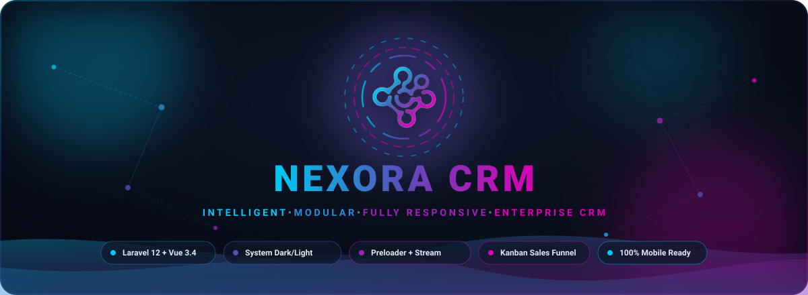
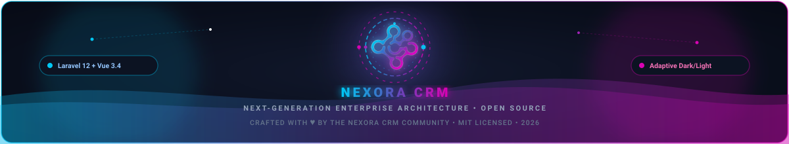

<div align="center">

<!-- Animated Header Interactive Banner (Self-contained vector SVG styled with Nexora Brand Gradient: Cyan #01C7F4 → Blue #2590D6 → Indigo #5A4DB9 → Violet #9E24B7 → Magenta #D803B3) -->
<a href="#-security-philosophy--posture">
  
</a>

<!-- Animated SVG Live Telemetry & Security Status Ticker (Zero External Dependencies) -->
<div align="center">
  
</div>

<br/>

<!-- Security Governance & Compliance Badges (Matching Logo Colorway) -->
<p align="center">
  
  
  
  
  
  <a href="LICENSE"></a>
</p>

<!-- Quick Navigation Links -->
<p align="center">
  <a href="#-security-philosophy--posture"><b>🛡️ Philosophy</b></a> •
  <a href="#-supported-versions--lifecycle"><b>📋 Versions</b></a> •
  <a href="#-vulnerability-reporting-protocol"><b>🚨 Reporting</b></a> •
  <a href="#-incident-response--triage-sla"><b>⏱️ Response SLA</b></a> •
  <a href="#-built-in-architectural-defenses"><b>🔐 Defenses</b></a> •
  <a href="#-production-hardening-checklist"><b>🌐 Server Hardening</b></a> •
  <a href="#-responsible-disclosure-hall-of-fame"><b>🏅 Hall of Fame</b></a> •
  <a href="#-community--maintainers"><b>👥 Maintainers</b></a>
</p>

</div>

---

<!-- Animated Gradient Divider -->


## 🛡️ Security Philosophy & Posture

At **Nexora** (NoxusCRM), the security, confidentiality, and integrity of customer data and corporate operations are foundational engineering priorities. As an enterprise CRM managing mission-critical client records, sales pipelines, financial quotes, confidential correspondence, and organizational credentials, Nexora is engineered under a strict **defense-in-depth** and **zero-trust** backend philosophy:

```
┌────────────────────────────────────────────────────────────────────────────────────────┐
│                        Nexora Security Engineering Pillars                             │
├───────────────────┬───────────────────┬──────────────────────┬─────────────────────────┤
│ 🛡️ Strict Defense │ 🔒 Privacy First  │ 🔑 Principle of      │ ⚡ Rapid Triage         │
│    in Depth       │    & Sovereignty  │    Least Privilege   │    & Patch Delivery     │
├───────────────────┼───────────────────┼──────────────────────┼─────────────────────────┤
│ • CSRF token auth │ • Zero telemetry  │ • Granular RBAC gates│ • < 72h first response  │
│ • PDO params only │ • Local DB storage│ • ACL module filters │ • Dedicated fix branches│
│ • Contextual XSS  │ • Encrypted creds │ • Strict file sandboxes • Coordinated disclosure│
└───────────────────┴───────────────────┴──────────────────────┴─────────────────────────┘
```

---

<!-- Animated Gradient Divider -->


## 📋 Supported Versions & Lifecycle

We actively maintain and provide security patches for the primary release branch. Please verify that your installation runs a supported version before reporting issues:

| Version Branch | Release Status | PHP Runtime | Laravel Base | Active Security Support | Critical Patch SLA |
|:---:|:---:|:---:|:---:|:---:|:---:|
| **`1.0.x` (`main`)** | **Current Stable** | **PHP 8.3 / 8.4 / 8.5** | **Laravel 12.x** | ✅ **Active Support** | **Within 7 Days** |
| `< 1.0.0` (Alpha/Beta) | Legacy / EOL | PHP < 8.3 | Laravel 11.x | ❌ End of Life | None (Upgrade Required) |

> [!IMPORTANT]
> Nexora instances running on unsupported PHP versions (PHP $\le$ 8.2) or outdated framework releases are strongly urged to upgrade immediately to receive the latest security fixes and performance patches.

---

<!-- Animated Gradient Divider -->


## 🚨 Vulnerability Reporting Protocol

We deeply appreciate the efforts of security researchers, ethical hackers, and community members who help protect Nexora. If you identify a security flaw or potential vulnerability, **please report it privately**.

> [!CAUTION]
> **DO NOT CREATE PUBLIC GITHUB ISSUES OR PULL REQUESTS FOR UNPATCHED SECURITY VULNERABILITIES.**  
> Public disclosure exposes live production CRM installations to immediate malicious exploitation.

### 📬 Submission Channels

You can submit reports through either of the following confidential channels:

#### Method 1: GitHub Private Vulnerability Reporting (Recommended)
1. Navigate to the official Nexora repository: [https://github.com/Isuru-CodeX/NoxusCRM](https://github.com/Isuru-CodeX/NoxusCRM).
2. Click the **Security** tab at the top of the repository.
3. Select **Advisories** from the left-hand navigation.
4. Click **Report a vulnerability** to open an encrypted private advisory draft directly with the maintainers.

#### Method 2: Confidential Maintainer Email
* **Email Address:** `security@nexora.io`
* **Subject Format:** `[SECURITY VULNERABILITY] Nexora CRM - <Vulnerability Type>`
* **PGP Encryption:** Available upon request for sensitive proofs of concept.

---

### 📋 What to Include in Your Vulnerability Report

To facilitate rapid triage, reproduction, and patch development, please include:

1. **Vulnerability Classification:** (e.g., Remote Code Execution, SQL Injection, Stored Cross-Site Scripting, Privilege Escalation, Broken Object-Level Authorization, CSRF).
2. **Affected Modules & Endpoints:** The specific package path (`packages/Webkul/...`), controller, or route URL.
3. **Step-by-Step Reproduction Guide:** Clear, deterministic instructions to reproduce the vulnerability from a fresh installation.
4. **Proof of Concept (PoC):** Minimal cURL command, HTTP request sample, or non-destructive script demonstrating the exploit.
5. **Impact Assessment:** Explanation of what customer data, credentials, or system privileges could be compromised.
6. **Suggested Remediation:** Any proposed code patch, configuration change, or architectural fix (if available).

---

### 🎯 Scope & Boundaries

<table>
  <tr>
    <td width="50%">
      <h3>🟢 In-Scope Vulnerabilities</h3>
      <ul>
        <li><strong>Remote Code Execution (RCE)</strong> in backend handlers or workers</li>
        <li><strong>SQL Injection (SQLi)</strong> in custom queries or DataGrids</li>
        <li><strong>Privilege Escalation</strong> bypassing Role-Based Access Control (RBAC)</li>
        <li><strong>Stored or Reflected Cross-Site Scripting (XSS)</strong></li>
        <li><strong>Cross-Site Request Forgery (CSRF)</strong> on state-changing actions</li>
        <li><strong>Authentication Bypass</strong> or session fixation vulnerabilities</li>
        <li><strong>Insecure Direct Object References (IDOR)</strong> in customer records</li>
        <li><strong>Arbitrary File Uploads</strong> or path traversal exploits</li>
        <li><strong>Sensitive Data Exposure</strong> or unauthorized EAV attribute disclosure</li>
      </ul>
    </td>
    <td width="50%">
      <h3>🔴 Out-of-Scope Issues</h3>
      <ul>
        <li>Volumetric Distributed Denial of Service (DDoS/DoS)</li>
        <li>Social engineering or phishing attacks targeting maintainers</li>
        <li>Automated scanner dumps (e.g., Nessus, Acunetix) without verified manual PoC</li>
        <li>Issues requiring physical access to an unlocked administrator workstation</li>
        <li>Self-XSS (attacks where the user must execute malicious code on themselves)</li>
        <li>Vulnerabilities in third-party services (e.g., SMTP server configurations)</li>
        <li>Theoretical issues lacking actionable reproduction steps</li>
      </ul>
    </td>
  </tr>
</table>

---

<!-- Animated Gradient Divider -->


## ⏱️ Incident Response & Triage SLA

Once a private vulnerability report is received, our security team adheres to the following coordinated response lifecycle:

```
┌────────────────────────────────────────────────────────────────────────────────────────┐
│                        Incident Response Operational Timeline                          │
├────────────────────┬────────────────────┬────────────────────┬─────────────────────────┤
│ 1. Initial SLA     │ 2. CVSS Triage     │ 3. Engineering Fix │ 4. Coordinated Release  │
├────────────────────┼────────────────────┼────────────────────┼─────────────────────────┤
│ • < 72 Hours       │ • < 5 Business Days│ • Isolated Branch  │ • Security Advisory     │
│ • Formal receipt   │ • Severity score   │ • Pest Regression  │ • Patch tag published   │
│ • Private channel  │ • Impact verified  │ • Quality testing  │ • Researcher credit     │
└────────────────────┴────────────────────┴────────────────────┴─────────────────────────┘
```

<br/>

| Severity Level | CVSS v3.1 Range | Initial Response SLA | Target Patch Window | Advisory Coordination |
|:---:|:---:|:---:|:---:|:---:|
| **Critical** | `9.0 - 10.0` | **< 24 Hours** | **< 7 Calendar Days** | Private patch distributed, CVE requested, public disclosure upon deployment. |
| **High** | `7.0 - 8.9` | **< 48 Hours** | **< 14 Calendar Days** | Patch published in next maintenance release with security advisory. |
| **Medium** | `4.0 - 6.9` | **< 72 Hours** | **< 30 Calendar Days** | Addressed in standard sprint release with full changelog documentation. |
| **Low** | `0.1 - 3.9` | **< 5 Business Days** | **Next Minor Version** | Addressed during routine maintenance updates. |

---

<!-- Animated Gradient Divider -->


## 🔐 Built-in Architectural Defenses

Nexora incorporates multi-layered technical controls at every layer of the application:

<table>
  <tr>
    <td width="50%">
      <h3>🛡️ Injection &amp; SQL Protection</h3>
      <ul>
        <li><strong>Eloquent ORM &amp; Parameterized Queries:</strong> All database queries executed through PDO prepared statements, neutralizing SQL injection vectors.</li>
        <li><strong>Strict Type Casting:</strong> Request parameters and model attributes strictly validated against database schema constraints.</li>
        <li><strong>EAV Sanitation:</strong> Entity-Attribute-Value custom fields validated against defined regex patterns and data types before persistence.</li>
      </ul>
    </td>
    <td width="50%">
      <h3>⚔️ XSS &amp; Template Escaping</h3>
      <ul>
        <li><strong>Context-Aware Blade Escaping:</strong> All Blade views utilize <code>{{ ... }}</code> syntax, automatically invoking <code>htmlspecialchars()</code> with UTF-8 encoding.</li>
        <li><strong>Vue.js 3 Reactive Binding:</strong> Dynamic UI elements bind via text interpolation (<code>v-text</code>, <code>{{ }}</code>), preventing arbitrary HTML injection.</li>
        <li><strong>Strict Rich-Text Sanitation:</strong> WYSIWYG email and note editors filter unapproved tags, event handlers, and JavaScript protocols.</li>
      </ul>
    </td>
  </tr>
  <tr>
    <td width="50%">
      <h3>🔑 CSRF &amp; Session Armor</h3>
      <ul>
        <li><strong>State-Changing CSRF Tokens:</strong> Every POST, PUT, PATCH, and DELETE request mandates a cryptographically secure CSRF token.</li>
        <li><strong>Hardened Session Cookies:</strong> Configured by default with <code>HttpOnly=true</code>, <code>SameSite=Lax</code> (or <code>Strict</code>), and <code>Secure=true</code> over HTTPS.</li>
        <li><strong>Automatic Session Invalidation:</strong> Active sessions are revoked upon password reset or role modification.</li>
      </ul>
    </td>
    <td width="50%">
      <h3>👥 Granular RBAC &amp; Access Gates</h3>
      <ul>
        <li><strong>ACL Verification:</strong> Every HTTP controller route verifies user permissions against the master Role-Based Access Control matrix.</li>
        <li><strong>Data Isolation:</strong> User boundaries restrict visibility to assigned leads, organizations, and pipeline deals based on hierarchy.</li>
        <li><strong>API Guard Tokens:</strong> Stateless API endpoints enforce token expiration and scope constraints.</li>
      </ul>
    </td>
  </tr>
  <tr>
    <td width="50%">
      <h3>📁 Secure File Management</h3>
      <ul>
        <li><strong>MIME Whitelisting:</strong> Avatar and document uploads strictly validated against allowed binary MIME types, ignoring deceptive file extensions.</li>
        <li><strong>Randomized Storage Hashes:</strong> Uploaded filenames replaced with SHA-256 random hashes to prevent directory traversal or name collisions.</li>
        <li><strong>Non-Executable Uploads:</strong> Files stored outside the public document root or protected via <code>storage/</code> symlinks without PHP execution rights.</li>
      </ul>
    </td>
    <td width="50%">
      <h3>🔒 Cryptography &amp; Secrets</h3>
      <ul>
        <li><strong>Modern Password Hashing:</strong> User credentials hashed using salted Bcrypt (cost factor 12) or Argon2id.</li>
        <li><strong>AES-256-GCM App Encryption:</strong> API tokens, IMAP mail credentials, and webhook secrets stored encrypted at rest using Laravel's AES cipher.</li>
        <li><strong>Zero Telemetry Leakage:</strong> Nexora communicates zero diagnostic telemetry, user analytics, or phone-home requests to external servers.</li>
      </ul>
    </td>
  </tr>
</table>

---

<!-- Animated Gradient Divider -->


## 🌐 Production Hardening Checklist

When deploying Nexora to production environments, implement the following operational hardening steps:

### 1. Web Server Security Headers (Nginx Configuration)

Ensure your Nginx server block injects standard protective headers:

```nginx
# Essential Production Security Headers
add_header X-Frame-Options "SAMEORIGIN" always;
add_header X-Content-Type-Options "nosniff" always;
add_header X-XSS-Protection "1; mode=block" always;
add_header Referrer-Policy "strict-origin-when-cross-origin" always;
add_header Strict-Transport-Security "max-age=31536000; includeSubDomains; preload" always;
add_header Permissions-Policy "camera=(), microphone=(), geolocation=()" always;

# Restrict Access to Hidden Files
location ~ /\.(?!well-known).* {
    deny all;
    access_log off;
    log_not_found off;
}
```

### 2. Environment Hardening (`.env`)

Verify the following production settings:

```env
APP_ENV=production
APP_DEBUG=false
APP_URL=https://crm.yourcompany.com

# Force HTTPS & Secure Cookies
SESSION_SECURE_COOKIE=true
SESSION_SAME_SITE=lax
```

```bash
# Generate a cryptographically secure 256-bit application key
php artisan key:generate --force

# Cache compiled configuration to lock out runtime tampering
php artisan config:cache
php artisan route:cache
php artisan view:cache
```

### 3. File System Permissions

Set restrictive Unix file ownership so only the web server (`www-data` or `nginx`) has read/write privileges where required:

```bash
sudo chown -R www-data:www-data /var/www/nexora
sudo find /var/www/nexora -type d -exec chmod 755 {} \;
sudo find /var/www/nexora -type f -exec chmod 644 {} \;
sudo chmod -R 775 /var/www/nexora/storage /var/www/nexora/bootstrap/cache
```

---

<!-- Animated Gradient Divider -->


## 🏅 Responsible Disclosure & Hall of Fame

We believe in acknowledging the valuable contributions of the security research community. Security researchers who discover a valid, previously unknown vulnerability and practice responsible coordinated disclosure will be:

* **Publicly credited** in the relevant Nexora Release Notes and Security Advisory.
* **Featured in our Security Hall of Fame** with their name, handle, and website link.
* **Provided a letter of recommendation** or verification of ethical contribution upon request.

*Thank you for helping keep Nexora and the entire open-source community safe!*

---

<!-- Animated Gradient Divider -->


## 🌐 Community & Maintainers

<div align="center">

### **Nexora CRM Open-Source Core Team**
*Enterprise-Grade Autonomous Customer Relationship Management*

<br/>

<!-- Community Links -->
<a href="https://github.com/Isuru-CodeX/NoxusCRM"></a>
<a href="https://github.com/Isuru-CodeX/NoxusCRM/issues"></a>
<a href="https://github.com/Isuru-CodeX/NoxusCRM/discussions"></a>
<a href="https://github.com/Isuru-CodeX/NoxusCRM/security"></a>

<br/><br/>

⭐ **If you find Nexora CRM helpful, give it a star on GitHub!** ⭐

<br/>

<a href="#-security-philosophy--posture"><b>⬆️ Back to Top</b></a>

<br/><br/>

</div>

---

<div align="center">

<!-- Animated Footer Interactive Banner (Self-contained vector SVG with Nexora Brand Gradient: Cyan #01C7F4 → Blue #2590D6 → Indigo #5A4DB9 → Violet #9E24B7 → Magenta #D803B3) -->
<a href="#-security-philosophy--posture">
  
</a>

</div>
